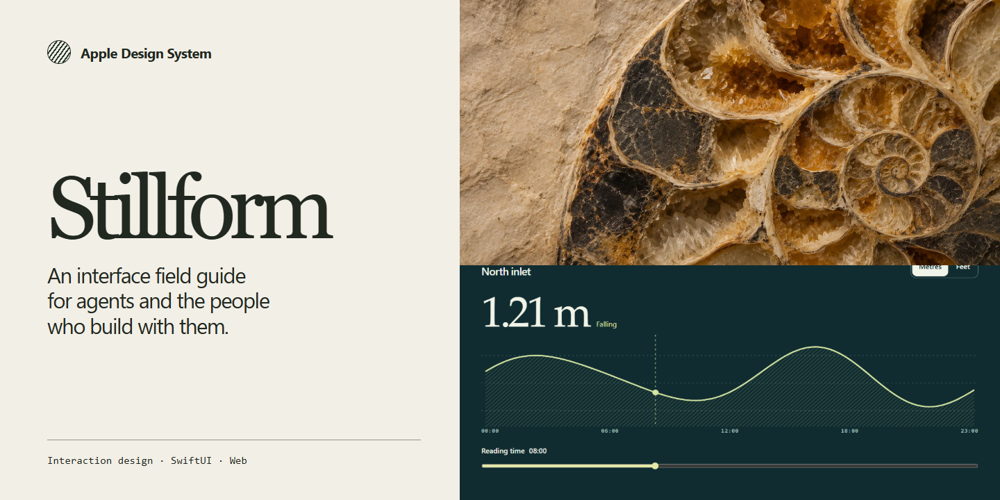

# Stillform

An independent, Apple-informed design system for agents building real product interfaces. It pairs interaction rules with executable HTML, CSS, JavaScript and SwiftUI. Each example includes the states that disappear from a polished screenshot, including empty results, interrupted work, failed storage and focus after dismissal.

**[Read the skill](skills/stillform/SKILL.md)** · **[Find a component](skills/stillform/references/components.md)** · **[Inspect an interface](skills/stillform/references/inspection.md)** · **[Download the release](https://github.com/Elias02345/Apple-Design-System/releases/latest)**

Run `python skills/stillform/scripts/route.py editor form cancellation` for a task-specific set of rules, acceptance checks and code paths. Each of the [20 machine-readable contracts](skills/stillform/references/contracts.json) identifies where it applies and how to test it. The [integration recipes](skills/stillform/references/recipes.md) show how to embed the same controls in another product.

## Use the skill

Download `stillform.zip` from the release and extract its `stillform` directory into `~/.codex/skills/`, or copy [skills/stillform](skills/stillform) from this repository. The resulting path is `~/.codex/skills/stillform/SKILL.md`. For another agent that reads skill folders, use its documented skill location. The examples work offline.

> Use $stillform to redesign the appointment editor. Keep our brand and navigation. Build the edit, cancel, error and retry paths. Test a narrow layout and keyboard-only use. Show what changed after inspecting the result.

## Working interfaces

For a platform-specific detail, give the agent a local Sketch kit and run `python skills/stillform/scripts/sketch.py "Apple iOS 27 UI Kit.sketch" buttons disabled --measure --limit 2`. It returns named variants, layer identifiers and measured bounds directly from the document. [Editable kit guide](skills/stillform/references/kits.md)

| Specimen cabinet | Tide book |
| --- | --- |
| [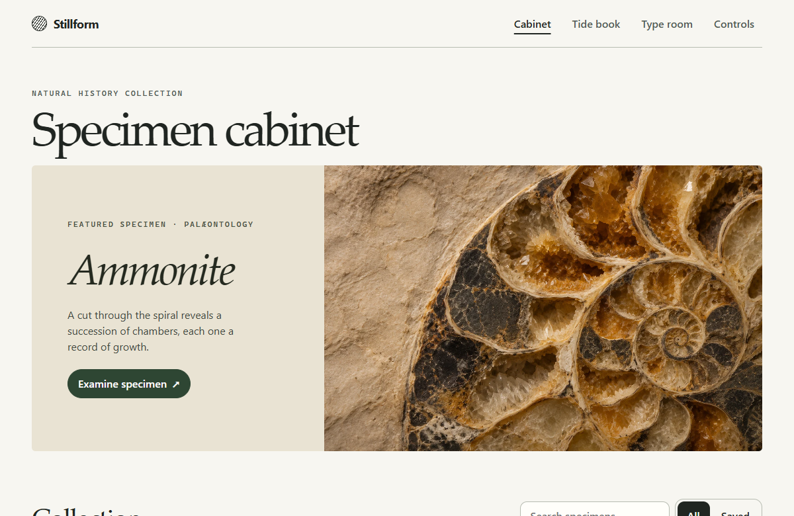](skills/stillform/assets/web/index.html) | [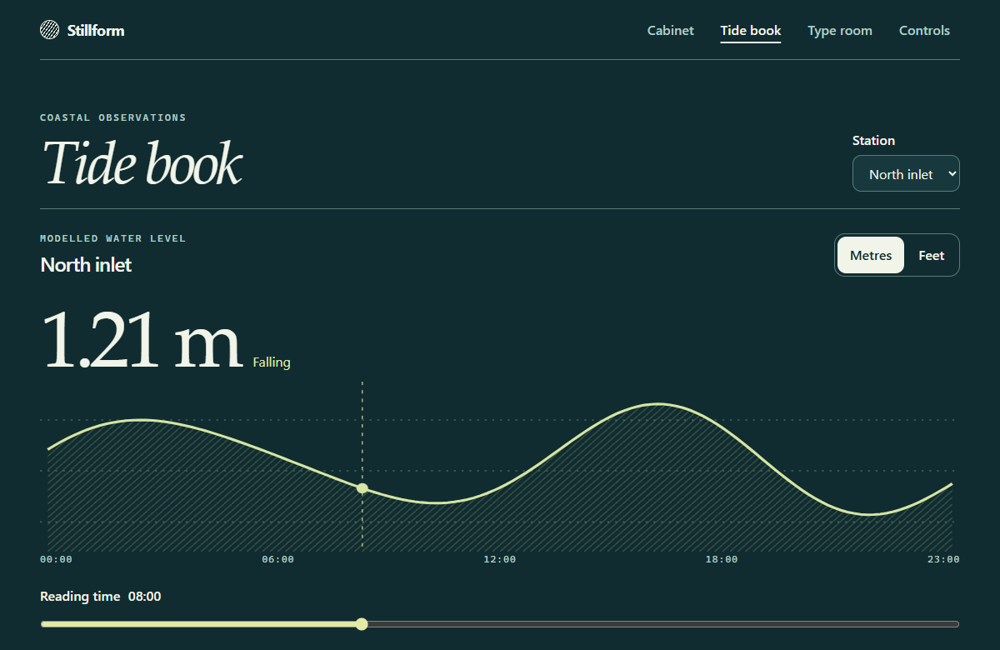](skills/stillform/assets/web/tide.html) |
| Inspect an object, save it, write a note and recover focus when the last filtered row disappears. [Interaction code](skills/stillform/assets/web/cabinet.js) | Scrub a reading, change its unit and compare the plot with the accessible table and saved log. [Interaction code](skills/stillform/assets/web/tide.js) |

| Type room | Control bench |
| --- | --- |
| [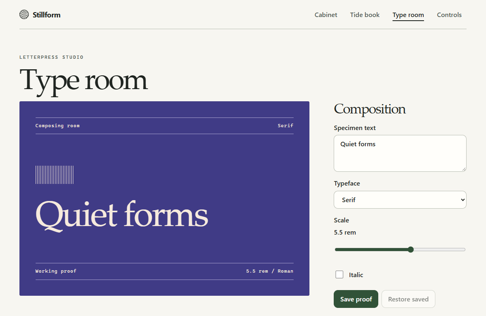](skills/stillform/assets/web/type.html) | [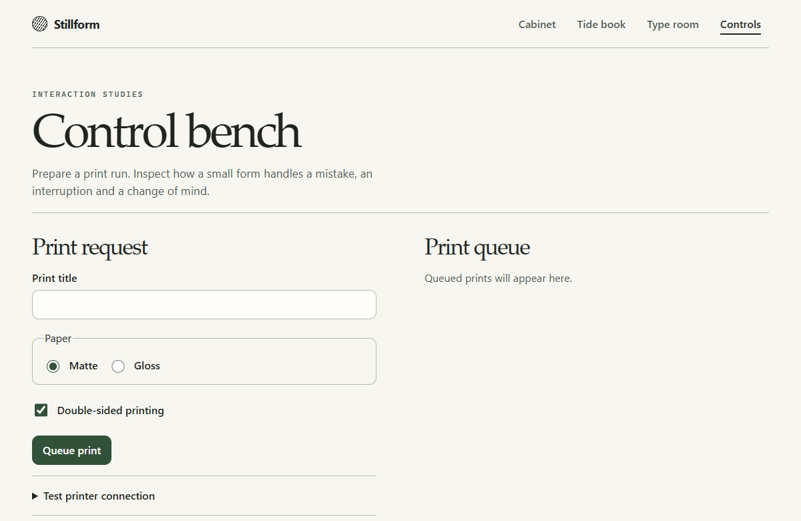](skills/stillform/assets/web/controls.html) |
| Edit a live proof, compare styles and restore the last committed version. [Interaction code](skills/stillform/assets/web/type.js) | Cancel a pending request, recover from an offline printer, remove a job and undo. [Interaction code](skills/stillform/assets/web/controls.js) |

Open [index.html](skills/stillform/assets/web/index.html) from a local copy to use the gallery. From a checkout, `npm run gallery` serves the examples on the loopback address printed in the terminal. The linked HTML files on GitHub open their source.

| Studio agenda | Light table |
| --- | --- |
| [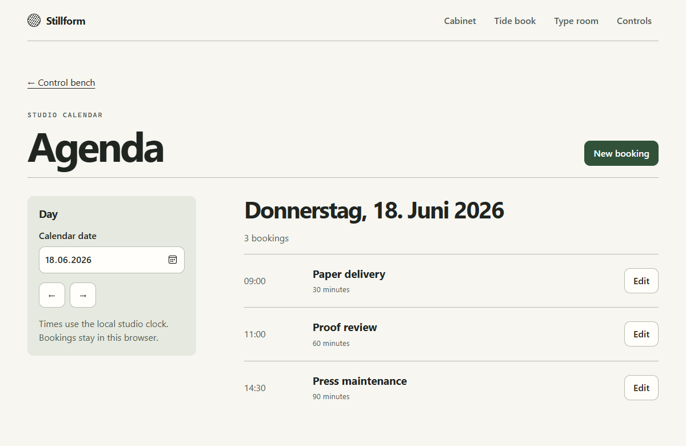](skills/stillform/assets/web/agenda.html) | [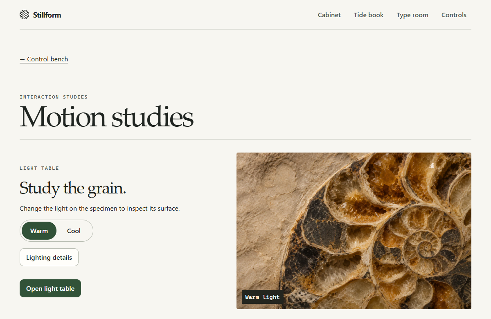](skills/stillform/assets/web/motion.html) |
| Move a booking into an occupied slot, recover the draft and save a valid time. Focus returns to the rescheduled booking. [Booking editor](skills/stillform/assets/web/agenda.js) | Change the light and reverse an opening disclosure. Selection stays immediate and the running transition follows the latest input. [Motion study](skills/stillform/assets/web/motion.js) |

## Motion in use

| Selection follows intent | A temporary editing surface |
| --- | --- |
| 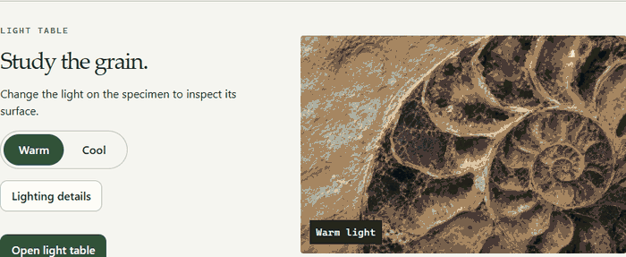 | 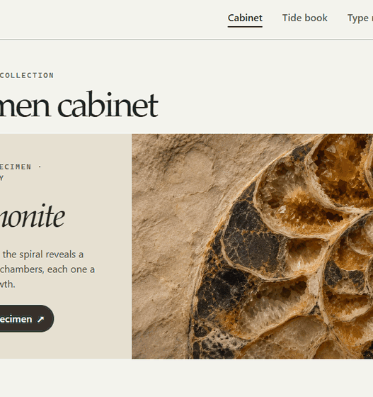 |
| The selected value updates immediately. The indicator and lighting treatment settle together. [Light-table code](skills/stillform/assets/web/motion.js) | The dialog owns focus while open. Closing restores focus to the appropriate control. [Dialog code](skills/stillform/assets/web/cabinet.js) |

Both recordings sample the running browser transitions. The live studies honor system reduced motion. [Motion contracts](skills/stillform/references/motion.md)

## Native SwiftUI

[Field Desk](skills/stillform/assets/swift) pairs a searchable split view with pinned notes, editable drafts, toolbar commands, a sheet and discard confirmation. The reusable FieldKit library targets iOS/iPadOS 17+ and macOS 14+. On a Mac:

```sh
cd skills/stillform/assets/swift
swift test
swift run FieldDesk
```

For Watch, TV and Vision, [SurfaceKit](skills/stillform/assets/apple-surfaces) implements a Crown-adjustable reading, a remote-focus station shelf and a spatial reading window. The [platform guide](skills/stillform/references/platforms.md) pairs each view with device-specific acceptance exercises.

<details>
<summary>See the views rendered by the macOS tests</summary>

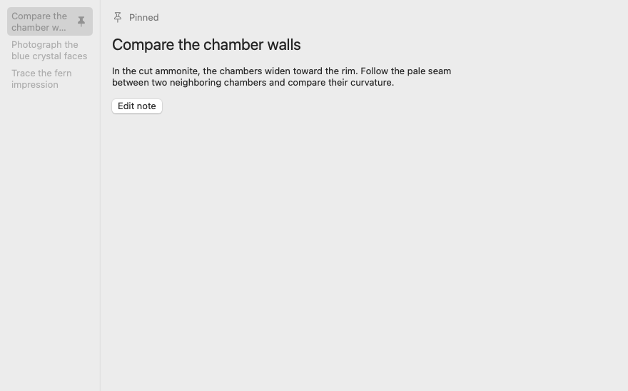

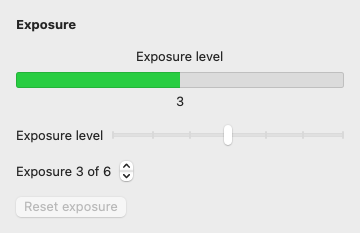

</details>

## Sources and evidence

The [searchable catalog](skills/stillform/references/sources.md) includes 173 HIG documents, 293 linked video sessions, 90 Apple sample-code articles and 30 Figma or Sketch kit links. Use `python skills/stillform/scripts/lookup.py "sheets" --media` to locate a topic's official illustrations and clips, or `python skills/stillform/scripts/lookup.py "accessibility" --kind sample` to locate downloadable Apple code. The original example artwork, code and recordings ship with Stillform. [Apple Developer Design](https://developer.apple.com/design/) · [Source scope](skills/stillform/references/sources.md)

The [inspection loop](skills/stillform/references/inspection.md) asks an agent to exercise a real task, capture a defect, repair its cause and rerun the failing case. The [browser suite](tests/flows.spec.cjs) checks state, persistence, interruption, focus, reduced motion, compact layout and automated accessibility. The [native tests](skills/stillform/assets/swift/Tests/FieldKitTests/JournalTests.swift) cover model identity, validation, filtering and persistence round-trips.

```sh
npm ci
npx playwright install
npm test
```

[Validation evidence](docs/validation.md) · [Release verification](release/VERIFY.md) · [Changelog](CHANGELOG.md) · [MIT license](LICENSE)
